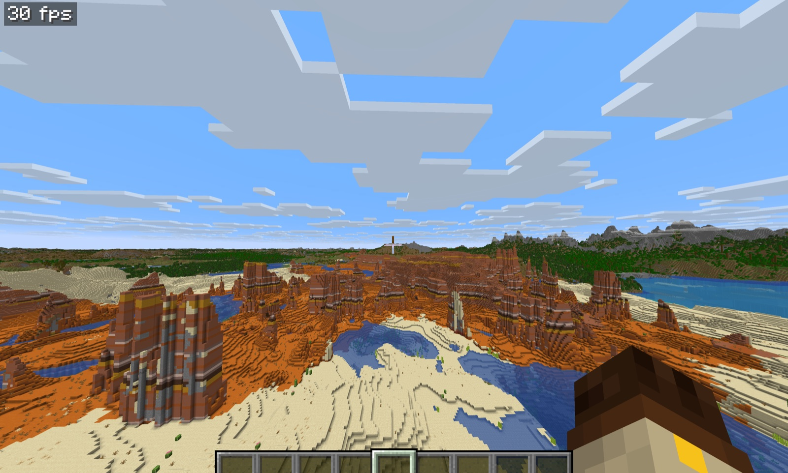
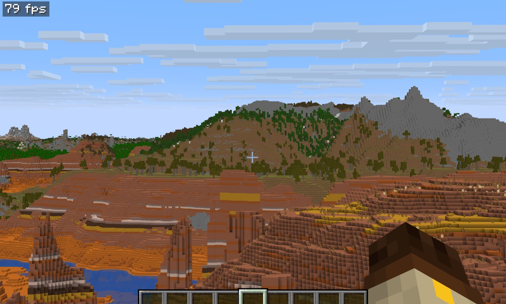

# Distant Horizons for Horizon (native mod)

A port of [Distant Horizons](https://gitlab.com/distant-horizons-team/distant-horizons)' level-of-detail
terrain to [Horizon](https://github.com/horizon-rust/horizon), the Rust rewrite of Minecraft: Java Edition 26.3.
It is a [horizon-mixins](https://github.com/horizon-rust/horizon-mixins) bundle that the Horizon launcher builds into
the game, like Horizon's official native mods.

Not made or endorsed by the Distant Horizons team or the Horizon project. Experimental: version 0.1.0.





## What it does

The world past your render distance, drawn as Distant Horizons draws it:

- **Built from the chunks you visit.** Each loaded chunk becomes Distant Horizons' full data (columns of runs:
  block, biome, height, block and sky light), merged into its 64 x 64-block leaf section and propagated up a
  quadtree to sections 16,384 blocks wide, each level merging 2 x 2 columns into one.
- **Distant generation.** In single player and as a LAN host, sections you haven't visited are sampled from the
  world generator, one column per data point, at the section's own detail level. Visited chunks always replace
  generated data (generation steps, as in Distant Horizons).
- **Detail drops with distance** by Distant Horizons' rule: `log(distance / unit) / log(base)`, with its five
  horizontal-quality presets.
- **Kept on disk**, per world and dimension, in `<world>/data/DistantHorizons/<dimension>/`, so a world loads its
  LODs at once the next time. A server you join keeps them in memory only.
- **Meshing as Distant Horizons does**: each run a box; tops and bottoms culled against the runs above and below;
  side faces cut where the adjacent column covers them and lit by the light they face; coplanar faces merged;
  hidden runs culled; dark underground runs folded away (cave culling); snow colours the block under it.
- Drawn by Horizon's far-terrain renderer with each block's own texture (mipmaps give the averaged colour Distant
  Horizons computes for far terrain), tinted by biome; the game's own chunks are cut out of the LODs.

## Install

A native mod is Rust source the launcher compiles into a game of its own: it does nothing dropped into
`horizon-mods/` (that folder is for WebAssembly `.hmod` mods). You need the Horizon launcher, the Nightly of
2026-10-29 (`d009ebd`) installed and prepared, Python 3 and this repository.

1. Make the set of native mods to build: this one, and any others (their `.hnmod` files from an instance's
   `horizon-native-mods/` folder, or bundle folders):

   ```sh
   python3 tools/horizon.py set --with ~/Library/Application\ Support/horizon/instances/native-mods/horizon-native-mods
   ```

   This writes `target/native-set/`. An instance's own build (`native-build` without a folder) takes only the
   native mods its Mods page installed, so a mod copied in by hand is left out without a word: name the set.
2. Build it, after reading the mods' source (they run with your rights):

   ```sh
   horizon-launcher native-build target/native-set --instance native-mods \
     --version nightly-2026-10-29-d009ebd --trust-native-code
   ```

   On macOS the launcher is `/Applications/Horizon.app/Contents/MacOS/horizon-launcher`. The first build
   downloads the launcher's own Rust and takes 10 to 30 minutes; later ones a few. `--version` names a prepared
   version; if it says one is "not prepared", pass the `d009ebd` Nightly as here.
3. Play the "Native mods" instance. Options > Mods lists Distant Horizons; `/dh` in chat shows its status. Far
   terrain fills in over the first minutes in a new world, and loads from disk after.

WebAssembly mods (Mod Menu...) keep working beside it, from the instance's `horizon-mods/` folder.

## Use it

Options > Mods > Distant Horizons > Settings:

| Button | Choices |
|---|---|
| Distant Horizons | On, off |
| LOD render distance | 64, 128, **256**, 512, 1024 chunks |
| Horizontal quality | Lowest, Low, **Medium**, High, Extreme |
| Distant generation | **On**, off |
| Cave culling | **On**, off |
| Debug detail colours | Off, on: each detail level its own colour, and a status box bottom left |

In chat, `/dh` shows the status; `/dh distance 512`, `/dh quality high`, `/dh generation off`, `/dh caves off`,
`/dh debug on`, `/dh on|off`, `/dh save` and `/dh clear` (forget the LODs; they are made again). Tab completes
them, as it does the game's own commands.

Horizon's own far terrain (Video Settings > LOD Distance) draws in the same place: Distant Horizons waits while it
is on, and says so in chat once.

## How it is made

| File | What it is |
|---|---|
| `mixins/distant_horizons/runtime.rs` | The Distant Horizons core in Rust, knowing nothing of Horizon; also this crate's library, for its tests. Added to the game as `game::distant_horizons` |
| `mixins/distant_horizons/bridge.rs` | Horizon's side: block table, chunk and generator adapters, meshes in Horizon's far-terrain format, the session per world. Added as `game::distant_horizons_bridge` |
| `mixins/distant_horizons/*.rs` (others) | One small helper per hook |
| `mixins/distant_horizons/horizon-mixin.toml` | The bundle: two modules, seven HEAD hooks on Horizon's native hook points, and one RETURN hook on `Game::terrain_distance`, so the renderer's range, depth and fog reach the LODs |
| `tools/horizon.py` | Apply on the pinned Horizon, check, test inside the game, build, package the `.hnmod` |

What was ported, Java class by class:

| Distant Horizons | Here (`runtime.rs`) |
|---|---|
| `DhSectionPos` | `pos` (same bit layout) |
| `FullDataPointUtil` | `full_point` (same bit layout) |
| `FullDataPointIdMap` | `IdMap` |
| `FullDataSourceV2` (same-level update, 2 x 2 merge from children, down-sampling to children, id remapping) | `FullDataSource` |
| `FullDataOcclusionCuller` | `cull_hidden_data_points` |
| `LodDataBuilder.createFromChunk` | `create_from_chunk` |
| `WorldGenerationQueue` + a generator's LOD generation | `generate_missing`, the engine's `Section` jobs |
| `LodQuadTree` detail logic, `EDhApiHorizontalQuality` | `DetailPlan`, `HorizontalQuality` |
| `FullDataToRenderDataTransformer`, `RenderDataPointUtil` | `render_column`, `render_point` |
| `ColumnBox`, `LodQuadBuilder` merging | `build_quads`, `merge_quads` |
| `FullDataUpdatePropagatorV2`, `FullDataSourceProviderV2` | the engine's `Chunk` jobs and store |
| SQLite repository | `storage`: one zlib file per section |

Where it differs from Distant Horizons, and why:

- **Render colour bits hold the block's id**, not an averaged colour: Horizon draws far terrain with block textures,
  so the colour comes from the texture and the biome tint at draw time. Merging and culling compare the ids as
  Distant Horizons compares colours.
- **Far sections are generated at their own detail level**, and a 2 x 2 merge from children only overwrites a
  column when all four child columns have data, so one visited chunk never blanks the generated terrain around it.
- **Non-colliding blocks (grass, flowers) pass on only their light**, not their colour: with textures, their colour
  on the ground below would draw them as a carpet.
- **Section files instead of SQLite**, in the same layout; the file is keyed to Horizon's block registry and
  remade when it changes.
- Not ported (yet): Distant Horizons' own renderer and shaders (Horizon's draws the tiles), its networking and
  server-side generation, the API, beacons and clouds, its config screens (replaced by the settings page and `/dh`),
  and vertical-quality reduction.

## Build and test

```sh
cargo test                                                     # the core: 14 tests
cargo clippy --all-targets -- -D warnings
python3 tools/horizon.py check --horizon ../horizon            # apply on the pinned Horizon, cargo check the game
python3 tools/horizon.py test --horizon ../horizon             # the same tests inside the game's test binary
python3 tools/horizon.py build --horizon ../horizon            # the game with the mod (fast profile)
python3 tools/horizon.py build --horizon ../horizon --with ../horizon-mods/native   # ... with other native mods in
python3 tools/horizon.py package                               # target/distant_horizons-0.1.0.hnmod
```

`--horizon` is a Horizon clone holding the pinned commit (without it the commit is downloaded from GitHub). The
built game needs resources prepared from your own Minecraft 26.3:

```sh
./target/cargo/fast/horizon-client --resources /path/to/.local/horizon-client/26.3
```

`python3 tools/proof.py --resources PATH` drives that game with `horizon-ctl` on fresh temporary folders and
checks the mod end to end (Options > Mods, sections drawn, the view with it on and off, files saved).

## Tested on

Developed and tested on a **MacBook Pro with an Apple M5 chip, 16 GB of memory and 1 TB of storage**, on macOS
with Metal. The frame rates in the screenshots and in [VALIDATION.md](VALIDATION.md) are from that machine. Linux
and Windows builds of Horizon should work the same way, but have not been tried.

## Compatibility

Pinned to Horizon `d009ebd` (the Nightly of 2026-10-29) and horizon-mixins `0d6b103` (`compatibility.json`). That
Horizon still has the WebAssembly mods' runtime, so `.hmod` mods run beside it, and Horizon's official native mods
(Minimap, Zoom, FPS Counter, Keystrokes, Recipes, Coordinates HUD) build into the same game: all of them were
checked together in a running game.

Unlike those official mods it reads the game's chunks, world generator and renderer and hooks `terrain_distance`,
which are not stable hook points, so it is pinned rather than built on any Horizon: a newer Nightly needs it
re-pinned and checked (`bridge.rs` is where changes would go).

Ported from Distant Horizons at `bbf57309` (core `7548006a`).

## Credits

- **Distant Horizons**, by James Seibel and its contributors: everything this port knows about level of detail
  comes from their work. If you play Minecraft: Java Edition, use the real thing.
- **Horizon**, by Ludovic and its contributors, and **horizon-mixins**, by levzzz5154: the game, its far-terrain
  renderer, the native hook points and the tooling that make a mod like this possible.
- The port was made by Deniz Şahin together with **Claude** (Claude Opus 5.5, Anthropic's AI model), which read
  both codebases, wrote the Rust port, the Horizon bridge, the tests and the build tooling, and found and fixed its
  bugs with Deniz testing in the game. Thank you, Claude.

## License

LGPL-3.0, as Distant Horizons: [LICENSE](LICENSE) (with the GPL it builds on, [COPYING.GPL](COPYING.GPL)).
Distant Horizons is Copyright (C) 2020 James Seibel and its contributors. `tools/horizon.py` is adapted from
horizon-mods' native tools (MIT). This repository contains no Minecraft code, assets or data.
