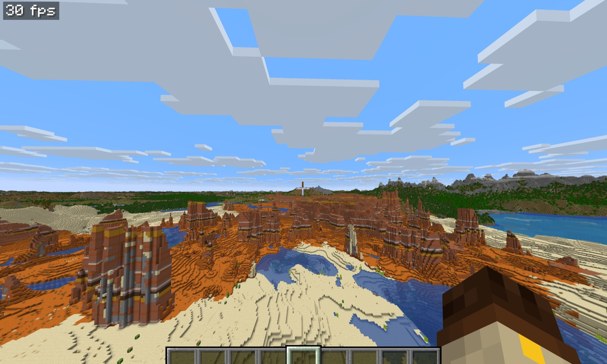
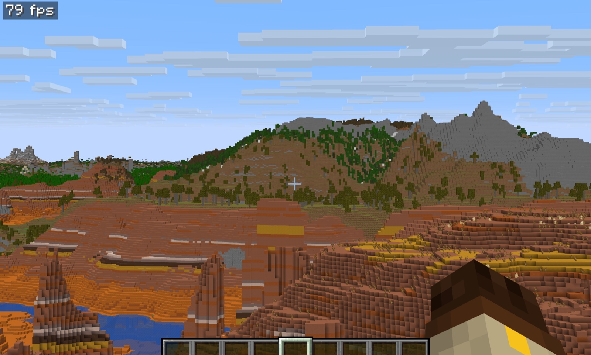

# Distant Horizons for Horizon Client

[Distant Horizons](https://gitlab.com/distant-horizons-team/distant-horizons)' level-of-detail terrain, ported to
Rust for [Horizon](https://github.com/horizon-rust/horizon) (the Rust rewrite of Minecraft: Java Edition 26.3). A
native mod: a [horizon-mixins](https://github.com/horizon-rust/horizon-mixins) bundle the Horizon launcher builds
into the game, like Horizon's official native mods.

Not made or endorsed by the Distant Horizons team or the Horizon project. Experimental, version 0.1.0.





## Features

- **LODs from visited chunks**: each chunk becomes Distant Horizons' full data (columns of runs: block, biome,
  height, block and sky light) in its 64 x 64 leaf section, merged 2 x 2 up a quadtree to 16,384-block sections.
- **Distant generation** (single player, LAN host): unvisited sections sampled from the world generator, one column
  per data point, at their own detail level. Visited chunks always replace generated data (generation steps, as in
  Distant Horizons).
- **Detail by distance**: `log(distance / unit) / log(base)`, with the five horizontal-quality presets.
- **Saved per world and dimension** in `<world>/data/DistantHorizons/<dimension>/`; loaded at once next time.
- **Servers**: Fabric/NeoForge with Distant Horizons 3.3.4 (protocol 16), Paper with Distant Horizons Support 0.14
  (protocol 15, answered in it) or 0.15.
  - The server sends its LODs (generated there) and pushes block changes.
  - Saved in `horizon-mods/.horizon-mod-data/distant_horizons/servers/<server>/<level>/`. On rejoin they load from
    disk and only changes are fetched (sync on load).
  - All compressions read in plain Rust: none, LZ4, Zstandard, LZMA2 (XZ).
  - No Distant Horizons on the server, or Server LODs off: LODs are built from received chunks, same folder.
  - Plugin with `builder_type: None`: only LODs it already has (pregenerated) are sent; the rest come from your
    chunks.
- **Meshing as Distant Horizons**: a box per run, tops/bottoms culled against neighbours, sides cut where covered
  and lit by what they face, coplanar faces merged, hidden runs culled, dark underground runs folded away (cave
  culling), snow tints the block below.
- **Drawn by Horizon's far-terrain renderer** with block textures (mipmaps give the averaged far colour) and biome
  tints; the game's own chunks are cut out.

## Install

A native mod is source the launcher compiles into its own game build, so it can't be dropped in like a
WebAssembly `.hmod`.

**Installer (macOS, Linux):** get `distant-horizons-for-horizon-client-<version>.zip` from
[Releases](https://github.com/denizsahin7744/distant-horizons-for-horizon-client/releases), unzip, run
`install.command` (macOS: double-click; first time right-click > Open) or `./install.sh` (Linux). It finds the
launcher, installs and prepares the pinned Nightly if needed, keeps the native mods already on in your "Native
mods" instance, asks, and builds. Then play "Native mods". Needs the launcher signed in with an account owning
Minecraft: Java Edition.

**By hand (any OS, Windows too):** needs the Horizon launcher, the Nightly of 2026-10-29 (`d009ebd`) installed and
prepared, Python 3 and this repository.

1. Make the set of native mods (this one plus any `.hnmod` files from an instance's `horizon-native-mods/`, or
   bundle folders):

   ```sh
   python3 tools/horizon.py set --with ~/Library/Application\ Support/horizon/instances/native-mods/horizon-native-mods
   ```

   Writes `target/native-set/`. Name the set: `native-build` without one only takes mods installed from the
   instance's Mods page and silently skips hand-copied ones.
2. Read the mods' source (they run with your rights), then build:

   ```sh
   horizon-launcher native-build target/native-set --instance native-mods \
     --version nightly-2026-10-29-d009ebd --trust-native-code
   ```

   macOS launcher: `/Applications/Horizon.app/Contents/MacOS/horizon-launcher`. First build downloads the
   launcher's Rust, 10 to 30 minutes; later ones a few. On "not prepared", pass the `d009ebd` Nightly as above.
3. Play "Native mods". Options > Mods lists Distant Horizons; `/dh` shows status. A new world fills in over the
   first minutes, then loads from disk.

WebAssembly mods (Mod Menu...) still work from the instance's `horizon-mods/` folder.

## Settings

Options > Mods > Distant Horizons > Settings (defaults bold):

| Setting | Choices |
|---|---|
| Distant Horizons | On, off |
| LOD render distance | 64, 128, **256**, 512, 1024 chunks |
| Horizontal quality | Lowest, Low, **Medium**, High, Extreme |
| Distant generation | **On**, off (also whether the server generates unvisited areas) |
| Cave culling | **On**, off |
| Debug detail colours | **Off**, on: a colour per detail level, status box bottom left |
| Server LODs | **On**, off: ask the server for LODs; off, build them from your chunks |
| Real-time updates | **On**, off: the server pushes block changes |
| Sync on load | **On**, off: check saved LODs with the server on joining |
| Server bandwidth | Unlimited, 250, **500**, 1000, 2000, 5000 KB/s (the server's limit applies too) |
| Server folder | **Name only**, IP only, Name and IP, Name, IP and port, Name, IP, port and MC version |

Server settings apply immediately. Server folders are named as Distant Horizons does, from the server list entry
(unlisted: the address, e.g. `127.0.0.1_25565`); a server sending its own key uses that.

Chat: `/dh` (status), `/dh distance 512`, `/dh quality high`, `/dh generation off`, `/dh caves off`,
`/dh debug on`, `/dh server off`, `/dh realtime off`, `/dh sync off`, `/dh bandwidth 1000|unlimited`,
`/dh folder name|ip|name-ip|name-ip-port|name-ip-port-version`, `/dh on|off`, `/dh save`, `/dh clear` (forget
LODs, rebuilt after). Tab completes.

With Horizon's own far terrain on (Video Settings > LOD Distance), Distant Horizons pauses and says so once.

## Code

| File | Contents |
|---|---|
| `mixins/distant_horizons/runtime.rs` | The Horizon-free Distant Horizons core (`game::distant_horizons`) |
| `mixins/distant_horizons/bridge.rs` | Horizon side: block table, chunk and generator adapters, meshes in the far-terrain format, session per world, server connection (`game::distant_horizons_bridge`) |
| `mixins/distant_horizons/net.rs` | Multiplayer protocol, client side: messages, session config, split payloads, data decoding, request queues (`game::distant_horizons_net`) |
| `mixins/distant_horizons/codec.rs` | LZ4, Zstandard, XZ/LZMA2 decoders in plain Rust; bundles can't add dependencies (`game::distant_horizons_codec`) |
| `mixins/distant_horizons/inbox.rs` | The server's Distant Horizons messages, taken from the connection's events (Horizon library, `distant_horizons_inbox`) |
| `mixins/distant_horizons/*.rs` (others) | One helper per hook |
| `mixins/distant_horizons/horizon-mixin.toml` | The bundle: five modules, seven HEAD hooks, RETURN hooks on `Game::terrain_distance` (range, depth, fog reach the LODs) and `net::Session::poll` (messages to the inbox) |
| `src/lib.rs` | Cargo library over the Horizon-free modules, for `cargo test` and clippy |
| `tools/horizon.py` | Apply on the pinned Horizon, check, test in the game, build, package the `.hnmod` |

Ported classes:

| Distant Horizons | Here |
|---|---|
| `DhSectionPos`, `FullDataPointUtil` | `pos`, `full_point` (same bit layouts) |
| `FullDataPointIdMap` | `IdMap` |
| `FullDataSourceV2` (update, 2 x 2 merge, down-sampling, id remapping) | `FullDataSource` |
| `FullDataOcclusionCuller` | `cull_hidden_data_points` |
| `LodDataBuilder.createFromChunk` | `create_from_chunk` |
| `WorldGenerationQueue` + LOD generation | `generate_missing`, engine `Section` jobs |
| `LodQuadTree` detail logic, `EDhApiHorizontalQuality` | `DetailPlan`, `HorizontalQuality` |
| `FullDataToRenderDataTransformer`, `RenderDataPointUtil` | `render_column`, `render_point` |
| `ColumnBox`, `LodQuadBuilder` merging | `build_quads`, `merge_quads` |
| `FullDataUpdatePropagatorV2`, `FullDataSourceProviderV2` | engine `Chunk` jobs and store |
| SQLite repository | `storage`: a zlib file per section |
| `NetworkSession`, `FullDataSourceV2DTO`, `AbstractFullDataNetworkRequestQueue` (client), messages | `net.rs` |
| lz4-java, zstd-jni, xz-java (`EDhApiDataCompressionMode`) | `codec.rs` |

Differences from Distant Horizons:

- **Colour bits hold the block id**: the colour comes from texture and biome tint at draw time. Merging and culling
  compare ids as Distant Horizons compares colours.
- **Far sections generated at their own detail level**; a 2 x 2 merge only overwrites a column when all four
  children have data, so one visited chunk never blanks generated terrain.
- **Non-colliding blocks (grass, flowers) pass on only light**, else textures would draw them as a carpet.
- **Section files instead of SQLite**, same layout, keyed to Horizon's block registry (remade when it changes).
- **Server LODs under the game's mod data** (a client has no world folder), per server (its key, else its address)
  and level.
- **Not ported**: Distant Horizons' renderer and shaders, its server side (LAN hosts generate locally), the API,
  beacons, clouds, config screens (replaced by the settings page and `/dh`), vertical-quality reduction.

## Build and test

```sh
cargo test                                                     # core, protocol, codecs: 30 tests
cargo clippy --all-targets -- -D warnings
python3 tools/horizon.py check --horizon ../horizon            # apply on the pinned Horizon, cargo check
python3 tools/horizon.py test --horizon ../horizon             # the tests inside the game's test binary
python3 tools/horizon.py build --horizon ../horizon            # the game with the mod (fast profile)
python3 tools/horizon.py build --horizon ../horizon --with ../horizon-mods/native   # with other native mods
python3 tools/horizon.py package                               # target/distant_horizons-0.1.0.hnmod
python3 tools/horizon.py interop --horizon ../horizon --address 127.0.0.1:25565   # against a live server
```

`--horizon`: a Horizon clone with the pinned commit (else downloaded from GitHub). Run the built game with
resources from your own Minecraft 26.3:

```sh
./target/cargo/fast/horizon-client --resources /path/to/.local/horizon-client/26.3
```

- `tools/proof.py --resources PATH`: drives the game with `horizon-ctl` on fresh temporary folders (Options > Mods,
  sections drawn, view on vs off, files saved).
- `tools/server_proof.py --resources PATH [--server host:port] [--limit s]`: the same on a server (offline mode,
  player `DhProof` an operator): received, drawn, saved; second join loads from disk and syncs up to date.
- `interop`: Horizon's connection alone, no game: requests, decoding, sync on load.
- `tools/codec_fixtures.py`: rewrites `tools/fixtures/` with the reference compressors (the `dhs-unfinished` ones via
  `tools/DhsFixtures.java` and xz-java, if Java is installed).

## Tested on

MacBook Pro (Apple M5, 16 GB, 1 TB), macOS, Metal; frame rates in the screenshots and
[VALIDATION.md](VALIDATION.md) are from it. Servers: Linux (Ubuntu 24.04, Mesa software Vulkan under Xvfb) against
Fabric with Distant Horizons 3.3.4 and Paper with Distant Horizons Support 0.14.0 and 0.15.0-SNAPSHOT. Windows
untested.

## Compatibility

Pinned to Horizon `d009ebd` (Nightly 2026-10-29) and horizon-mixins `0d6b103` (`compatibility.json`). WebAssembly
`.hmod` mods run beside it; Horizon's official native mods (Minimap, Zoom, FPS Counter, Keystrokes, Recipes,
Coordinates HUD) build into the same game, all checked together.

It uses unstable internals (chunks, world generator, renderer, `terrain_distance`), so it is pinned: a newer
Nightly needs re-pinning and checking (changes go in `bridge.rs`).

Ported from Distant Horizons `bbf57309` (core `7548006a`).

## Credits

- **Distant Horizons**, by James Seibel and contributors: everything here about level of detail comes from their
  work. On Minecraft: Java Edition, use the real thing.
- **Horizon**, by Ludovic and contributors, and **horizon-mixins**, by levzzz5154: the game, its far-terrain
  renderer, the hook points and tooling.
- Ported by Deniz Şahin with **Claude** (Claude Opus 5.5, Anthropic), which read both codebases, wrote the port,
  bridge, tests and tooling, and fixed bugs with Deniz testing in game. Thank you, Claude.

## License

LGPL-3.0, as Distant Horizons: [LICENSE](LICENSE) (with [COPYING.GPL](COPYING.GPL)). Distant Horizons is Copyright
(C) 2020 James Seibel and contributors. `tools/horizon.py` is adapted from horizon-mods' native tools (MIT). No
Minecraft code, assets or data included.
